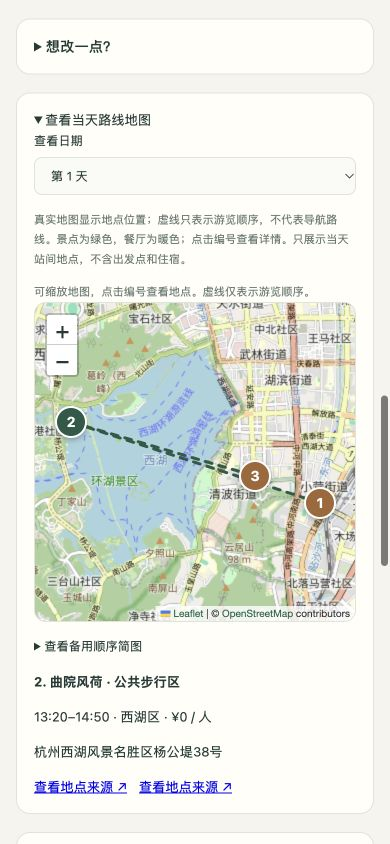

# MoonTrip 功能演示

[直接播放新版演示](https://kleinrat.github.io/Traveling/demo.html) · [下载MP4](https://kleinrat.github.io/Traveling/media/moontrip-demo-2026-10-21.mp4)

2026-10-20至21日实际公网页面操作，功能代码基线 `06553e6c3c10`。视频为分步截图编排，**非连续录屏**；真实 AI 等待时间经过压缩，无旁白、带中文说明。H.264、1920×1080、10fps、91秒，1,838,134字节。地图署名保留。

## 演示流程

| 时段 | 内容 |
|---|---|
| 00:00–00:05 | 先拿到路书，再按自己的节奏调整；杭州 / 成都 · 不含住宿 · MoonBit 负责规划与校验 |
| 00:05–00:12 | 01  描述你想怎样旅行；杭州两天，预算 800 元，10 点出门，自然与美食优先 |
| 00:12–00:15 | 02  让 Kimi 整理旅行条件；本次为真实公网请求；等待时间在演示中压缩 |
| 00:15–00:23 | 03  核对 AI 理解，再确认；预算、作息和兴趣清楚列出；确认前不会替换当前路书 |
| 00:23–00:29 | 04  直接阅读按时间排列的路书；两天预计 291 元 / 人，预算余量 509 元 / 人 |
| 00:29–00:35 | 午餐、景点、晚餐，衔接在同一条时间线上；餐饮为人均估算；接驳暂用片区估算，出行前核实 |
| 00:35–00:41 | 05  在真实底图上看当天地点；编号对应时间线；虚线只表示顺序，不是道路导航 |
| 00:41–00:45 | 切换日期，只查看当天安排；地图保留 Leaflet 与 OpenStreetMap 署名 |
| 00:45–00:50 | 06  想换地点时，再打开候选；景点与餐厅分类展示，可加入路书或替换一站 |
| 00:50–00:54 | 餐厅候选单独查看；按品牌及相似名称抑制重复；消费不是实时菜单报价 |
| 00:54–00:58 | 选择心仪地点，指定替换哪一站；曲院风荷替换第一天的柳浪闻莺，保留日期和餐次 |
| 00:58–01:05 | 07  先看变化，再决定是否接受；预计 291 → 305 元 / 人，接驳与后续时间重新校验 |
| 01:05–01:10 | 接受后，路书和预算一起更新；曲院风荷进入行程，预计花费变为 305 元 / 人 |
| 01:10–01:14 | 不满意，可以撤销；恢复原行程，费用回到 291 元 / 人 |
| 01:14–01:18 | 08  保存 HTML 路书，方便随时查看；本次已实际下载；另支持 Markdown 与 JSON 导出 |
| 01:18–01:22 | 也可以用条件和预设直接规划；切换成都与周末轻旅行，不调用 AI 也能生成 |
| 01:22–01:27 | 同一套 MoonBit 规则，也适用于成都；本次手动方案预计 377 元 / 人，包含两天午晚餐 |
| 01:27–01:31 | 打开应用；实际页面分步演示，非连续录屏 |

杭州行程使用2026-10-24至25日，真实 kimi-k2.6 提取每人800元、10:00–18:00、自然 / 美食等条件，确认后生成。替换曲院风荷后费用由291变305元，撤销恢复291元。成都为手动选择周末轻旅行，无需额外 AI 请求。

本次通过“保存这份路书”实际下载 HTML，检查了日期及晚餐内容；视频未展示打开离线文件。地图虚线只表示顺序；餐饮与片区接驳费用为估算。公网 AI 可用性受网络、模型余额及托管额度影响。

视频 SHA-256：`b1ba2b68282539982b13ae767cdbe7d794d90ec9046c396437cd7b0f6c7de50c`。

新版保留于 main 的公开媒体目录，不替换 v0.1.0 的历史 Release 资产。

## 历史归档：v0.1.0

[下载45秒演示视频](https://github.com/Kleinrat/Traveling/releases/download/v0.1.0/moontrip-v0.1.0.mp4)

2026-10-14实际公网页面操作截图编排，1280×864、H.264、45秒、无旁白、非连续录屏。地图署名保留。视频展示代码基线9a1eb400ceb0；后续发布提交仅整理文档和版本资料。

## 操作顺序

| 时段 | 操作 |
|---|---|
| 00–05秒 | 杭州、懒人旅行、2天、2026-10-17出发、每人全程1000元 |
| 05–10秒 | 生成路书，查看活动 / 费用 / 预算与时间线 |
| 10–15秒 | 查看第一天午晚餐和片区接驳估算 |
| 15–20秒 | 真实地图、编号与来源详情 |
| 20–25秒 | 切换第二天地图 |
| 25–30秒 | 分类浏览未安排地点 |
| 30–35秒 | 用曲院风荷替换柳浪闻莺，预览费用291→305元 |
| 35–40秒 | 接受调整，路书和预算更新 |
| 40–45秒 | 撤销恢复，提示可保存离线路书 |

公网版手动条件规划，未演示AI请求。费用为估算，地图虚线表示順序，不是道路导航。保存离线路书由DOM交互检查验证，视频最后一幕没有实际触发下载。资料不足、预算不足的分支见测试记录。

## 手机地图验收

390×844视口，地图编号、切换日期、地点详情与底部署名可阅读。桌面和手机视口是浏览器模拟尺寸，非实体手机性能验收。

